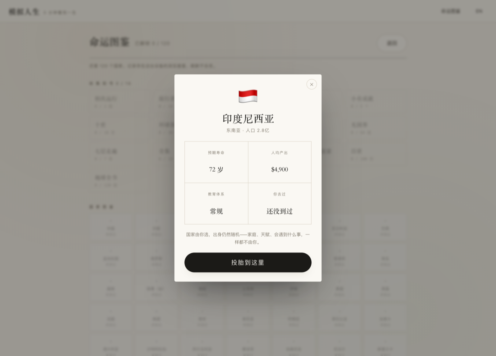

# 模拟人生 · 3 分钟看完一生

> 随机投胎到一个国家，随机拿到一副身体、一个家庭。然后几十年，几万天，眨眼就过去。

一个纯前端的人生模拟器。零依赖，一个 HTML 文件就能跑。

**[在线体验 →](https://game.workagentpro.com)** ｜ [单文件版](dist/life-in-3-minutes.html)（下载后双击即玩，不需要联网）


---

## 它是什么

你点一下「投胎」，系统给你一个随机的出生地、一个家庭阶层、一副身体和一组天赋。
接着时间开始走，从 0 岁到死亡，大约三分钟。中间你会遇到大约 12 次需要自己拿主意的事——
要不要继续念书、去大城市还是留下、接不接那份要搬家的升职、父母病了怎么办。

每一次选择都会真的改变后面的几十年。走完之后，你会拿到一张卡片、一个评级，和一句墓志铭。


## 内容规模

| 项目 | 数量 |
|---|---|
| 国家 | **120** 个，带真实人口、预期寿命、人均产出、教育体系、社会流动性 |
| 人生事件 | **386** 条 |
| 需要抉择的事件 | **64** 个 |
| 命运阶层 | **7** 层，从赤贫到顶级富豪 |
| 城乡 | 城市 / 农村两套独立事件线 |
| 结局成就 | 19 个 |
| 图鉴收集称号 | 18 个 |

## 四个入口

**投胎** —— 纯随机，按人口加权。

**今日之命** —— 同一天所有人拿到同一个种子，投到同一个胎，走完之后能看到自己今天排第几。

**指定国家** —— 在命运图鉴里点任意一个国家，看它的档案，然后「投胎到这里」。
国家由你选，出身仍然随机：家庭、天赋、会遇到什么事，一样都不由你。



**岔路回溯** —— 结局页的「未走的路」会列出这一生所有分叉，每条都可以点「走这条」，
真的从那个路口重新走完一生，看看另一条路通向哪里。


## 一些设计上的取舍

**投胎概率为什么要压缩。**
如果完全按真实人口加权，中国 + 印度会占 36%，而最小的国家只有 0.033%（约 3000 次才抽到一次）。
蒙特卡洛算下来，集齐 120 个国家期望要 **7101 局**，图鉴等于摆设。
所以实际用的是 `权重 ∝ 人口^0.55`：中印合计降到 12%，最小的国家抬到 0.18%，
既保留「人多的地方更容易出生」的真实感，又让收集这件事有可能完成。

**财富两极分化怎么来的。**
不是随机发钱，是让钱自己去滚：每个阶层有不同的资本回报率（赤贫 1.8% → 顶级富豪 7.2%），
同时富人每年要扣掉 1.3% 的资产当生活开销。同一套规则下，4 万次模拟跑出来
中位财富 $35k、99% 分位 $57M、0.36% 的人成为亿万富翁。

**选择为什么会重复。**
一开始全库只有 23 个抉择事件，一局要做 7 次选择，等于三局就把池子走一遍。
后来补到 64 个，并且记住上一局做过哪些选择——同一件事再遇到时权重打 0.18 折。
相邻两局的重复率从 29% 降到 9.4%。

**「回到那个路口」是怎么做到的。**
引擎用种子驱动的确定性随机（mulberry32），同样的种子 + 同样的选择 = 同一条人生。
所以只要把选择记录重放一遍，在目标路口换一个选项，就能真的走另一条路。
有个坑：很多选择本身不消耗随机数，换完选项后后面的事件流会和原来一模一样，
实测 33% 的回溯结果完全相同。解决办法是在分叉那一刻用「种子 + 路口序号」派生一个新种子重新掷骰，
修完之后 199/200 必然不同。

**分数分位表是算出来的。**
`tools/sim.js` 会跑 4 万次完整人生，把分数、寿命、财富、快乐度的分布统计成 101 个分位点，
写进 `js/data-dist.js`。所以你看到的「超过了 94.1% 的人生」是真的从这个模型里算出来的。

## 技术实现

- **零依赖**：没有框架、没有打包器、没有 CDN。原生 HTML + CSS + Canvas 2D。
- **单文件构建**：`node tools/build.js` 把所有 JS/CSS 内联成一个 295KB 的 HTML，gzip 后约 100KB。
- **确定性随机**：`mulberry32` + 显式种子，支持重放与回溯。
- **分享卡片**：Canvas 现场绘制 1080×1440 的卡片，底部带一个预生成的二维码（矩阵直接内联在代码里，运行时不需要二维码库）。
- **可选的统计服务**：`server/collect.py`，Python 标准库实现，零依赖，见下。

## 目录结构

```
.
├── index.html              页面骨架
├── css/style.css           样式
├── js/
│   ├── data-countries.js   120 个国家、姓名池、7 层阶层与权重
│   ├── data-events.js      386 条事件（含 64 个抉择）
│   ├── data-dist.js        4 万次模拟生成的分位表（自动生成，勿手改）
│   ├── engine.js           人生推演引擎（纯逻辑，可在 Node 里跑）
│   └── app.js              界面、存档、卡片、图鉴
├── tools/
│   ├── build.js            打包成单文件
│   ├── sim.js              批量模拟 + 生成分位表
│   ├── verify-track.js     无头浏览器跑完整一局，校验埋点
│   └── shot*.js            截图自检
├── server/collect.py       可选的访问统计服务
└── dist/                   构建产物
```

## 本地运行

不需要安装任何东西，直接打开 `index.html` 就行。

改完之后重新打包：

```bash
node tools/build.js        # 生成 dist/life-in-3-minutes.html
```

重新生成分位表（改了数值平衡之后必须跑）：

```bash
node tools/sim.js 40000
```

截图 / 埋点自检需要浏览器：

```bash
npm i
npx playwright install chromium
npm run shot
npm run check:track
```

## 自建统计（可选）

`server/collect.py` 是一个零依赖的访问统计服务，只用 Python 标准库。
它收埋点、按月存 JSONL、提供一个带密码的面板。不存原始 IP，只存加盐哈希。

```bash
python3 server/collect.py       # 监听 127.0.0.1:8099
```

默认把数据写在脚本同目录，可以用 `LIFE_STATS_BASE` 改。
生产环境建议放在网站根目录**之外**，再用 nginx 反代 `/c`、`/stats`，面板加 basic auth。
（这一点很重要：如果把服务目录放在网站根目录里，`collect.py` 会被直接下载。）

## 数据与隐私

游戏本身不联网也能玩，所有存档（图鉴、成就、连续天数）都在浏览器的 localStorage 里，不上传。
只有在线版会匿名上报几个事件（打开、开始、完成、停留时长），用于统计有多少人玩到哪里。
不存原始 IP，不存任何账号信息。

## 内测数据

上线 6 天的真实数字：**243 位访客投胎 302 次，149 人点了开始，67 局走到结局**——
完成率 45%，对一个「点进来随便看看」的网页游戏来说算不错。

结局评级分布：SSS 2 局、SS 19 局、S 28 局、A 18 局、B 19 局、C 25 局、D 15 局、E 15 局。

## 授权

本项目采用 **[PolyForm Noncommercial License 1.0.0](LICENSE)**：

- ✅ 可以自由阅读、修改、fork、用于个人学习与娱乐
- ✅ 可以用于教学、研究、非营利组织
- ❌ **不得用于任何商业用途**（包括但不限于：加广告、卖课、做成付费产品、放进商业产品里）

商业授权或其他合作，欢迎开 issue 或邮件联系，可以细谈。

## 说明

- 代码与文案均为原创。
- 「模拟人生」是 Electronic Arts《The Sims》系列的中文商标，本项目与 EA 无任何关系。
  个人非商业使用没有问题，但如果要商用，请自行更换名称。
- 如果你 fork 之后做了改动，欢迎提 PR 或者告诉我一声，我会很开心。
